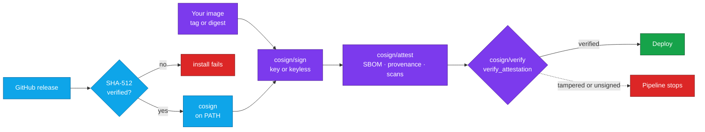

<div align="center">


# Cosign Orb for CircleCI

### Sign, verify and attest your container images in CircleCI, with or without keys to manage.

Install [Sigstore Cosign](https://github.com/sigstore/cosign) and sign your images, OCI artifacts and files with two steps of CircleCI config,<br>
keyless through CircleCI OIDC or with your own key, on public Sigstore or fully private infrastructure.<br>
Strict SHA-512 verification by default · No `sudo` · Cosign v1, v2 and v3 · amd64 and arm64

[](https://circleci.com/gh/juburr/cosign-orb)
[](https://circleci.com/developer/orbs/orb/juburr/cosign-orb)
[](LICENSE)
[](https://discuss.circleci.com/c/ecosystem/orbs)

[](https://github.com/sigstore/cosign)
[](docs/keyless-signing.md)
[](#-checksum-verification)
[](#-supported-platforms)
[](#-secure-by-design)

**[Quick Start](#-quick-start)** · **[Features](#-why-cosign-orb)** · **[Recipes](#-recipes)** · **[Key Management](#-key-management)** · **[Commands](#-commands)** · **[Security](#-secure-by-design)** · **[Network Access](#-network-access)**

<sub>An unofficial, community-maintained orb. [Contributions are welcome!](#-contributing)</sub>

</div>

<br>

```yaml
steps:
  - cosign/install
  - cosign/sign:
      image: "myregistry.com/myimage:${CIRCLE_SHA1}"
      keyless: true   # No keys to create, store, or rotate
```

Two steps, and your image carries a signature tied to the CircleCI project that built it. Prefer your own keys, or can't use the public transparency log? The same commands sign with a private key and keep everything inside your infrastructure.

## ✨ Why cosign-orb?

<table>
<tr>
<td width="33%" valign="top">
🔏 <b>Keyless, or bring your own key</b><br><br>
Set <code>keyless: true</code> and the signature is tied to the CircleCI project that built the image, through CircleCI OIDC, with no keys to create, store or rotate. Prefer your own keys? Keep them in a CircleCI context and pass the variable's <i>name</i>.
</td>
<td width="33%" valign="top">
📦 <b>Images, charts and files</b><br><br>
Sign container images and any other OCI artifact, Helm charts included, by tag or digest. <code>sign_blob</code> and <code>verify_blob</code> cover release tarballs and other plain files.
</td>
<td width="33%" valign="top">
📜 <b>Attestations next to the image</b><br><br>
Attach SBOMs (SPDX, CycloneDX), vulnerability reports, SLSA provenance or your own predicate type, and check them before you deploy with <code>verify_attestation</code>.
</td>
</tr>
<tr>
<td width="33%" valign="top">
🏢 <b>Private infrastructure ready</b><br><br>
With a private key, nothing goes to the public Rekor transparency log, and keyless signing can point at your own Fulcio and Rekor. Works with CircleCI Server deployments, and suits NIST 800-171, CMMC and other regulated environments.
</td>
<td width="33%" valign="top">
🔖 <b>Every Cosign major</b><br><br>
Cosign v1, v2 and v3 on amd64 and arm64 runners, with the right flags for each chosen for you. <a href="#pin-the-signature-storage-format"><code>bundle_format</code></a> pins how signatures are stored, so a Cosign upgrade can't silently change it.
</td>
<td width="33%" valign="top">
🛡️ <b>Hardened by default</b><br><br>
Every Cosign download is checked against a known SHA-512, failing closed on unknown versions. Keys go to a private temporary directory, locked to <code>0400</code> and destroyed with <code>shred</code> after use. <a href="#-secure-by-design">No <code>sudo</code>, no telemetry</a>.
</td>
</tr>
</table>

Signing in CI lets you prove that an image was built by your pipeline and detect tampering, because verification fails if an image was modified after it was signed. That supports SLSA, NIST 800-171, CMMC and other supply chain security frameworks. Every release of the orb is tested against Cosign v1, v2 and v3, `install` caches the verified binary so repeat runs skip the download, and secrets are handled according to CircleCI's [security recommendations](https://circleci.com/docs/security-recommendations/).

### 🧩 The Orb vs. a Hand-Rolled Script

| | Scripting Cosign yourself | With the orb |
| --- | --- | --- |
| **Installing Cosign** | Download a release, then find and check its checksum yourself | `cosign/install` checks a SHA-512 from a built-in table for amd64 and arm64, fails closed on unknown versions, and caches the binary |
| **Signing without a public log** | Different flags for each Cosign major: `--no-tlog-upload` (v1), `--tlog-upload=false` (v2), an empty signing config (v3) | Chosen for you from the installed Cosign version |
| **Keyless signing** | Request a token with `circleci run oidc get`, work out your organization's issuer URL, and pass both to Cosign | `keyless: true` |
| **Keyless verification** | Build the certificate identity and issuer patterns from your organization and project IDs | Detected automatically when verifying images from the same project |
| **Private key handling** | Decode the key, restrict its permissions, and wipe it afterwards, even when a step fails | Written with `0400` permissions to a private temporary directory, never the working directory, and destroyed with `shred` when the step exits, whether it passed or failed |
| **Cosign upgrades** | Cosign 3 changed the default signature storage format | `bundle_format` pins the format, and the verify commands enforce it |

## 🔄 How It Works



`cosign/install` downloads Cosign straight from its official GitHub releases, verifies its SHA-512 checksum in the default `strict` mode shown here, and puts it on `PATH`. See [Checksum Verification](#-checksum-verification) for the other modes. `cosign/sign` resolves a tag to the digest the registry serves and signs that digest, with your private key or, with `keyless: true`, a short-lived certificate tied to your CircleCI project. `cosign/attest` attaches SBOMs, provenance or scan results the same way. Later, `cosign/verify` and `cosign/verify_attestation` fail the step, and stop the pipeline before deploy, when an image was modified after signing or has no matching signature.

## 🚀 Quick Start

Keyless signing is the recommended setup: sign container images without managing keys, using CircleCI's OIDC identity. Copy this into `.circleci/config.yml`:

```yaml
version: 2.1

orbs:
  cosign: juburr/cosign-orb@latest

jobs:
  build-and-sign-keyless:
    docker:
      - image: cimg/base:current
    steps:
      - checkout
      - setup_remote_docker
      - run:
          name: Build and Push Image
          command: |
            docker build -t myregistry.com/myimage:${CIRCLE_SHA1} .
            docker push myregistry.com/myimage:${CIRCLE_SHA1}
      - cosign/install
      - cosign/sign:
          image: "myregistry.com/myimage:${CIRCLE_SHA1}"
          keyless: true
          # No keys required! Uses CircleCI OIDC token automatically
      - cosign/verify:
          image: "myregistry.com/myimage:${CIRCLE_SHA1}"
          keyless: true
          # Identity and issuer auto-detected for same-project verification

workflows:
  release:
    jobs:
      - build-and-sign-keyless
```

Swap in your registry and image, push, and the signature lands in your registry next to the image, recorded in the public Sigstore transparency log. `verify` works out the expected identity and issuer from the job's project and organization IDs, so verifying in the same project needs no extra parameters. Signing with your own key instead? See [Sign with a Private Key](#sign-with-a-private-key). The [Keyless Signing Guide](docs/keyless-signing.md) covers the details.

> [!TIP]
> **Prerequisites for keyless signing:** CircleCI Cloud or CircleCI Server 4.x+, with OIDC enabled for your organization. Run `cosign/check_oidc` to confirm a token is available.

> [!NOTE]
> **Privacy note:** Keyless signatures are recorded in the public Rekor transparency log, which includes your CircleCI organization and project IDs. To keep signatures off the public log, sign with a private key instead.

> [!TIP]
> Upgrading from `sign_image`, `verify_image` or the old `generate_key_pair` parameters? See [the renames](#unreleased-renamed-commands-and-parameters) under Upgrading.

## 🍳 Recipes

Copy-paste snippets for common tasks. Each one assumes the orb is imported as `cosign`, as in the [Quick Start](#-quick-start).

| 🖼️ Images | 📄 Blobs | 📜 Attestations | 🔑 Keys and Setup |
| --- | --- | --- | --- |
| [Sign with a private key](#sign-with-a-private-key)<br>[Sign with annotations](#sign-with-annotations)<br>[Sign by digest](#sign-by-digest-images-helm-charts-and-other-oci-artifacts)<br>[Pin the storage format](#pin-the-signature-storage-format)<br>[Verify a signature](#verify-an-image-signature)<br>[Verify a keyless signature](#verify-a-keyless-signature) | [Sign and verify a blob](#sign-and-verify-a-blob-arbitrary-file)<br>[Keyless blobs](#keyless-sign-and-verify-a-blob-recommended) | [Attach and verify](#attach-and-verify-attestations)<br>[Keyless attestations](#keyless-attestations-recommended) | [Generate a test key pair](#generate-key-pair-developmenttesting)<br>[Key management](#-key-management)<br>[Install Cosign only](#installation-only) |

### Sign with a Private Key

Sign images using a private key stored in a CircleCI context. See [Key Management](#-key-management) and the [Private Key Signing Guide](docs/private-key-signing.md) for key generation and setup instructions.

```yaml
version: 2.1

orbs:
  cosign: juburr/cosign-orb@latest

jobs:
  build-and-sign:
    docker:
      - image: cimg/base:current
    steps:
      - checkout
      - setup_remote_docker
      - run:
          name: Build and Push Image
          command: |
            docker build -t myregistry.com/myimage:${CIRCLE_SHA1} .
            docker push myregistry.com/myimage:${CIRCLE_SHA1}
      - cosign/install:
          version: "3.1.3"
      - cosign/sign:
          image: "myregistry.com/myimage:${CIRCLE_SHA1}"
          # Requires COSIGN_PRIVATE_KEY and COSIGN_PASSWORD in your context

workflows:
  release:
    jobs:
      - build-and-sign:
          context: cosign-keys  # the context that holds your keys
```

With a private key, `sign` never uploads to the public transparency log.

### Generate Key Pair (Development/Testing)

> [!CAUTION]
> Generate a throwaway key pair for testing. For production, use a key management system.

```yaml
steps:
  - cosign/install
  - cosign/generate_key_pair
  # Keys are now available as COSIGN_PRIVATE_KEY, COSIGN_PUBLIC_KEY, COSIGN_PASSWORD
  - cosign/sign:
      image: "myregistry.com/myimage:latest"
```

The password is random unless the variable named by `password_env_var` (`COSIGN_PASSWORD` by default) is already set, for example from a context. It is never passed as a parameter.

### Sign with Annotations

Add metadata to your signatures with annotations:

```yaml
steps:
  - cosign/install
  - cosign/sign:
      image: "myregistry.com/myimage:${CIRCLE_SHA1}"
      annotations: "build.commit=${CIRCLE_SHA1},build.pipeline=${CIRCLE_PIPELINE_NUMBER}"
```

### Sign by Digest (Images, Helm Charts, and Other OCI Artifacts)

`sign` and `attest` always sign a digest. Pass either a tag or a digest:

```yaml
steps:
  - cosign/install
  - cosign/sign:
      # Signed exactly as given, after checking that the registry serves this digest
      image: "ghcr.io/my-org/charts/my-chart@sha256:<64 hex characters>"
  - cosign/sign:
      # Resolved to registry.example.com:5000/team/app@sha256:... first; the registry port is kept
      image: "registry.example.com:5000/team/app:1.2.3"
```

How the digest is read:

- **crane** (used when installed) reads the registry directly. It works for any OCI artifact, including Helm charts, and is recommended.
- **docker** (fallback) uses the digest Docker recorded for the requested repository, then pulls `repository@digest` to confirm the registry serves it. Docker can only do this for content its engine can pull; Helm charts and other non-image artifacts need crane unless your Docker Engine uses the containerd image store.
- Any failure stops the step. The orb never falls back from crane to docker, and never signs a digest the registry did not confirm.

Only `sha256` digests are accepted, because that is what Cosign's reference parser supports. In a `repository:tag@sha256:...` reference the tag is ignored, as Cosign ignores it.

### Pin the Signature Storage Format

Cosign can store signatures and attestations in two layouts, and its default changed between major versions. Set `bundle_format` on `sign`, `attest`, `verify` and `verify_attestation` so a Cosign upgrade cannot silently change what lands in your registry:

```yaml
steps:
  - cosign/install
  - cosign/sign:
      image: "ghcr.io/my-org/app@sha256:<64 hex characters>"
      bundle_format: bundle
  - cosign/attest:
      image: "ghcr.io/my-org/app@sha256:<64 hex characters>"
      predicate: "./sbom.spdx.json"
      predicate_type: "spdxjson"
      bundle_format: bundle
  - cosign/verify:
      image: "ghcr.io/my-org/app@sha256:<64 hex characters>"
      bundle_format: bundle
```

| `bundle_format` | What `sign` and `attest` write for subject `sha256:<hex>` |
| --- | --- |
| `auto` (default) | Whatever the installed Cosign writes by default: `legacy` for Cosign 1 and 2, `bundle` for Cosign 3 (including the orb's default, 3.1.3). |
| `bundle` | One Sigstore bundle (`application/vnd.dev.sigstore.bundle.v0.3+json`) per signature or attestation, in an OCI 1.1 manifest whose `subject` is the digest. The manifest annotation `dev.sigstore.bundle.predicateType` is `https://sigstore.dev/cosign/sign/v1` for signatures, or the attestation's predicate type. Registries with the OCI referrers API index these natively. Other registries get an image index under the tag `sha256-<hex>` that lists them. Every run adds a new manifest. |
| `legacy` | The tag `sha256-<hex>.sig` for signatures and `sha256-<hex>.att` for attestations. Each is one image with one layer per signature or attestation, and every run adds a layer. |

With a private key, both formats skip the transparency log. On the verify commands, `bundle_format` names the format that must satisfy verification:

- Cosign is limited to that format wherever it has a switch for it.
- Two cases have no switch. Cosign 3 falls back to legacy objects when no bundle is attached, and Cosign 2.6.3+ switches to bundles whenever any are attached. In those cases the step verifies normally, then fails if objects in the other format also verify. If that second verification fails for any reason other than finding nothing that verifies (a registry or network error, for example), the step also fails, because the format cannot be confirmed.
- With `auto`, Cosign 2.6.3+ and 3 prefer bundles when present. Earlier Cosign 2 releases only read legacy objects.

**Choosing a format:**

| | `bundle` | `legacy` |
| --- | --- | --- |
| Cosign support | Write: Cosign 2.6.0+ (`sign`), 2.5.0+ (`attest`), and 3.x. Read: Cosign 2.6.0+ (`verify`), 2.5.0+ (`verify_attestation`), 3.x. | Every Cosign version. Cosign 3 deprecates it and plans to remove it in Cosign 4. In Cosign 3, private-key signing without a transparency log needs the deprecated `--tlog-upload=false --use-signing-config=false` flags. |
| Offline verification (`cosign save`, then `cosign verify --local-image`) | Works with Cosign 3.1.3 when the subject is a single image manifest (for example a Helm chart). Fails when the subject is an image index (for example a multi-platform image), and fails on Cosign 2.6.5. The saved layout stores the bundles as blobs that `index.json` does not list; Cosign 3 finds them by scanning the blobs. | Works with Cosign 2 and 3, for image manifests and image indexes. `index.json` lists the signatures and attestations (annotation `kind`: `dev.cosignproject.cosign/sigs` and `.../atts`). |
| Other tools | Need OCI referrers and Sigstore bundle support. | Read by older policy engines and admission controllers that only know `.sig`/`.att` tags. |

> [!TIP]
> Prefer `bundle` unless something that reads your signatures only understands `.sig`/`.att` tags, or you need offline verification of multi-platform images. Whichever you choose, set it explicitly in production pipelines. Keyless signing can pin the format its Cosign major writes by default (`legacy` for Cosign 1 and 2, `bundle` for Cosign 3), but cannot switch formats.

### Verify an Image Signature

```yaml
steps:
  - cosign/install
  - cosign/verify:
      image: "myregistry.com/myimage:${CIRCLE_SHA1}"
      # Requires COSIGN_PUBLIC_KEY in your context
```

> [!NOTE]
> `verify` passes only when Cosign verified an image signature. Cosign 2.6+ and 3 accept any Sigstore bundle signed by the key or identity, including an attestation, as a signature. An image that was attested but never signed therefore fails `verify`; check its attestations with `verify_attestation`.

An image can carry a legacy signature next to Sigstore bundle attestations, for example when it was signed with `bundle_format: legacy` and attested with Cosign 3's default. Cosign checks only bundles when an image has any:

- With Cosign 3 and `bundle_format: auto`, `verify` then checks the legacy signatures too.
- With `bundle_format: legacy`, Cosign 3 is limited to legacy signatures.
- Cosign 2.6.3 and later can't be limited to legacy signatures, so they can't verify such an image. Use Cosign 3, or sign in the bundle format.

### Verify a Keyless Signature

Verify images signed with keyless signing. When verifying images signed by the **same project**, parameters are auto-detected:

```yaml
steps:
  - cosign/install
  - cosign/verify:
      image: "myregistry.com/myimage:${CIRCLE_SHA1}"
      keyless: true
      # Auto-detects from CIRCLE_ORGANIZATION_ID and CIRCLE_PROJECT_ID
      # Only works for same-project verification!
```

For **cross-project** or **cross-organization** verification, specify the signing project's IDs:

```yaml
steps:
  - cosign/install
  - cosign/verify:
      image: "myregistry.com/myimage:${CIRCLE_SHA1}"
      keyless: true
      certificate_oidc_issuer: "https://oidc.circleci.com/org/<your-org-id>"
      certificate_identity_regexp: "https://circleci.com/api/v2/projects/<your-project-id>/pipeline-definitions/.*"
```

`cosign/check_oidc` prints these values for the project it runs in. Cosign 1 has no identity regular expressions: with `certificate_identity_regexp` (or the auto-detected pattern), it checks only the issuer and warns that the identity check was skipped. Pass `certificate_identity` for an exact match, or use Cosign 2 or 3. See the [Keyless Signing Guide](docs/keyless-signing.md) for details on certificate identity formats and verification options.

### Sign and Verify a Blob (Arbitrary File)

```yaml
steps:
  - cosign/install
  - cosign/sign_blob:
      blob: "./artifact.tar.gz"
      output_signature: "./artifact.tar.gz.sig"
      # Requires COSIGN_PRIVATE_KEY and COSIGN_PASSWORD in your context
  - cosign/verify_blob:
      blob: "./artifact.tar.gz"
      signature: "./artifact.tar.gz.sig"
      # Requires COSIGN_PUBLIC_KEY in your context
```

### Keyless Sign and Verify a Blob (Recommended)

Sign arbitrary files without managing keys using CircleCI's OIDC identity. Signatures are recorded in the public Sigstore transparency log.

```yaml
steps:
  - cosign/install
  - cosign/sign_blob:
      blob: "./artifact.tar.gz"
      keyless: true
      output_signature: "./artifact.tar.gz.sig"
      output_certificate: "./artifact.tar.gz.crt"  # Required for keyless blob signing
      # No keys required! Uses CircleCI OIDC token automatically
  - cosign/verify_blob:
      blob: "./artifact.tar.gz"
      signature: "./artifact.tar.gz.sig"
      certificate: "./artifact.tar.gz.crt"  # Certificate from signing step
      keyless: true
      # Auto-detects from CIRCLE_ORGANIZATION_ID and CIRCLE_PROJECT_ID
```

For **cross-project** verification, specify the signing project's IDs:

```yaml
steps:
  - cosign/install
  - cosign/verify_blob:
      blob: "./artifact.tar.gz"
      signature: "./artifact.tar.gz.sig"
      certificate: "./artifact.tar.gz.crt"
      keyless: true
      certificate_oidc_issuer: "https://oidc.circleci.com/org/<your-org-id>"
      certificate_identity_regexp: "https://circleci.com/api/v2/projects/<your-project-id>/pipeline-definitions/.*"
```

> [!IMPORTANT]
> Unlike image signing where certificates are stored in the registry, blob signing requires you to save the certificate file during signing and provide it during verification.

### Attach and Verify Attestations

Attach attestations (SBOMs, provenance, vulnerability reports) using a private key:

```yaml
steps:
  - cosign/install
  - cosign/attest:
      image: "myregistry.com/myimage:${CIRCLE_SHA1}"
      predicate: "./sbom.spdx.json"
      predicate_type: "spdxjson"
      # Requires COSIGN_PRIVATE_KEY and COSIGN_PASSWORD in your context
  - cosign/verify_attestation:
      image: "myregistry.com/myimage:${CIRCLE_SHA1}"
      predicate_type: "spdxjson"
      # Requires COSIGN_PUBLIC_KEY in your context
```

### Keyless Attestations (Recommended)

Attach attestations without managing keys using CircleCI's OIDC identity:

```yaml
steps:
  - cosign/install
  - cosign/attest:
      image: "myregistry.com/myimage:${CIRCLE_SHA1}"
      predicate: "./sbom.spdx.json"
      predicate_type: "spdxjson"
      keyless: true
      # No keys required! Uses CircleCI OIDC token automatically
  - cosign/verify_attestation:
      image: "myregistry.com/myimage:${CIRCLE_SHA1}"
      predicate_type: "spdxjson"
      keyless: true
      # Auto-detects from CIRCLE_ORGANIZATION_ID and CIRCLE_PROJECT_ID
```

For cross-project verification of keyless attestations, specify the signing project's IDs:

```yaml
steps:
  - cosign/install
  - cosign/verify_attestation:
      image: "myregistry.com/myimage:${CIRCLE_SHA1}"
      predicate_type: "spdxjson"
      keyless: true
      certificate_oidc_issuer: "https://oidc.circleci.com/org/<your-org-id>"
      certificate_identity_regexp: "https://circleci.com/api/v2/projects/<your-project-id>/pipeline-definitions/.*"
```

### Installation Only

Install Cosign and use it with custom commands:

```yaml
version: 2.1

orbs:
  cosign: juburr/cosign-orb@latest

jobs:
  example:
    docker:
      - image: cimg/base:current
    steps:
      - checkout
      - cosign/install:
          version: "3.1.3"
          verify_checksums: strict
      - run:
          name: Use Cosign
          command: cosign version

workflows:
  main:
    jobs:
      - example
```

## 🔑 Key Management

### Generating Keys

Generate a Cosign key pair for signing:

```bash
cosign generate-key-pair
# Creates cosign.key (private) and cosign.pub (public)
```

### Storing Keys in CircleCI

1. Base64-encode your keys:
   ```bash
   cat cosign.key | base64 -w 0 > cosign.key.b64
   cat cosign.pub | base64 -w 0 > cosign.pub.b64
   ```

2. Add to a CircleCI context:
   - `COSIGN_PRIVATE_KEY` - Contents of `cosign.key.b64`
   - `COSIGN_PUBLIC_KEY` - Contents of `cosign.pub.b64`
   - `COSIGN_PASSWORD` - The password used when generating keys

3. Give the jobs that sign or verify that context, as in [Sign with a Private Key](#sign-with-a-private-key). Stored under other names? Pass those names to `private_key`, `password` and `public_key`.

### Version Compatibility Note

> [!WARNING]
> Cosign v1 and v2+ use different key formats:
> - **v1**: `ENCRYPTED COSIGN PRIVATE KEY`
> - **v2+**: `ENCRYPTED SIGSTORE PRIVATE KEY`
>
> Keys generated with v2/v3 cannot be used with v1. If you need v1 compatibility, generate keys using Cosign v1.

## 📚 Learn More

| Guide | Description |
| --- | --- |
| [Keyless Signing Guide](docs/keyless-signing.md) | OIDC-based signing with CircleCI, Fulcio, and Rekor |
| [Private Key Signing Guide](docs/private-key-signing.md) | Traditional signing for air-gapped environments |
| [Roadmap](docs/ROADMAP.md) | Planned features and enhancements, including Cloud KMS integration (AWS KMS, GCP KMS, Azure Key Vault) and pre-built jobs for common workflows |

Elsewhere: [Cosign Documentation](https://docs.sigstore.dev/cosign/overview/) · [Sigstore Project](https://www.sigstore.dev/) · [CircleCI Orb Registry](https://circleci.com/developer/orbs/orb/juburr/cosign-orb) · [CircleCI Orb Documentation](https://circleci.com/docs/orb-intro/)

## 🧰 Commands

| Command | What it does |
| --- | --- |
| [`install`](#cosigninstall) | Download and install Cosign with checksum verification |
| [`check_oidc`](#cosigncheck_oidc) | Confirm a CircleCI OIDC token is available for keyless signing |
| [`sign`](#cosignsign) | Sign a container image or other OCI artifact, with a private key or keyless |
| [`verify`](#cosignverify) | Verify a container image signature |
| [`attest`](#cosignattest) | Attach an attestation (SBOM, provenance, scan results) to an image |
| [`verify_attestation`](#cosignverify_attestation) | Verify an attestation attached to an image |
| [`sign_blob`](#cosignsign_blob) | Sign an arbitrary file (blob) |
| [`verify_blob`](#cosignverify_blob) | Verify a blob signature |
| [`generate_key_pair`](#cosigngenerate_key_pair) | Generate a throwaway key pair for development and testing |

### `cosign/install`

Installs Cosign for Linux on amd64 or arm64, matching the executor's CPU. In the default `strict` mode it verifies the SHA-512 checksum first and refuses versions it has no checksum for; see [Checksum Verification](#-checksum-verification) for the opt-outs. Run it before the orb's other commands. Needs bash 4 or newer and `curl` or `wget` on the executor.

| Parameter | Default | Description |
| --- | --- | --- |
| `version` | `3.1.3` | Cosign release to install; a leading `v` is ignored. Values that aren't a release version, such as `latest`, are rejected. |
| `install_path` | *(empty)* | Absolute path of the directory to install into, writable without root. Empty means `$HOME/bin`. Created if needed, and added to `PATH` for later steps when it isn't already on it. A leading `~/` is expanded. |
| `verify_checksums` | `strict` | `strict`, `known_versions` or `false`. See [Checksum Verification](#-checksum-verification). |
| `caching` | `true` | Cache the downloaded release between jobs, keyed by version, CPU architecture and home directory. Only verified releases are cached, and a cached release is verified again before it is installed. |

### `cosign/check_oidc`

Confirms that the job has a CircleCI OIDC token (`CIRCLE_OIDC_TOKEN`) and prints its key claims: the issuer, organization, project and pipeline definition IDs, and the `certificate_oidc_issuer` and `certificate_identity_regexp` values to verify this project's signatures with. Fails the step if the job can't get a token. Run it before the keyless commands. It takes no parameters.

### `cosign/sign`

Signs a container image or other OCI artifact, Helm charts included. A tag is resolved to a digest first and the digest the registry serves is signed (see [Sign by Digest](#sign-by-digest-images-helm-charts-and-other-oci-artifacts)), which needs `crane` or `docker` on the executor. With a private key, nothing is uploaded to the transparency log. With `keyless: true`, the step requests a CircleCI OIDC token, gets a short-lived certificate from Fulcio and records the signature in Rekor.

| Parameter | Default | Description |
| --- | --- | --- |
| `image` | *required* | Image or OCI artifact by tag (`registry.com/image:tag`) or digest (`registry.com/image@sha256:...`). |
| `keyless` | `false` | Boolean. Sign through CircleCI OIDC instead of with a private key. Needs CircleCI Cloud or Server 4.x+ with OIDC enabled. |
| `private_key` | `COSIGN_PRIVATE_KEY` | *Name* of the environment variable that holds the base64-encoded private key. Ignored when `keyless` is true. |
| `password` | `COSIGN_PASSWORD` | *Name* of the environment variable that holds the private key's password. Ignored when `keyless` is true. |
| `annotations` | *(empty)* | Comma-separated `key=value` pairs to add to the signature, e.g. `"env=prod,team=platform"`. |
| `bundle_format` | `auto` | Signature storage format: `auto`, `bundle` or `legacy`. Keyless signing supports only `auto` and the installed Cosign major's own default. See [Pin the Signature Storage Format](#pin-the-signature-storage-format). |
| `fulcio_url` | `https://fulcio.sigstore.dev` | Fulcio CA URL. Keyless only. |
| `rekor_url` | `https://rekor.sigstore.dev` | Rekor transparency log URL. Keyless only. |
| `oidc_issuer` | *(empty)* | OIDC issuer URL, for private Fulcio instances. Empty means CircleCI's issuer for your organization, `https://oidc.circleci.com/org/<org-id>`, from `CIRCLE_ORGANIZATION_ID`. Keyless only. |

### `cosign/verify`

Verifies a container image signature with a public key or, with `keyless: true`, against the signing certificate's identity and OIDC issuer. When the identity and issuer parameters are empty, they are derived from `CIRCLE_PROJECT_ID` and `CIRCLE_ORGANIZATION_ID`, so verifying an image signed by the same project needs neither. Passes only when an image signature verified; an image that was only attested fails (see [Verify an Image Signature](#verify-an-image-signature)).

| Parameter | Default | Description |
| --- | --- | --- |
| `image` | *required* | Full image reference, e.g. `registry.com/image:tag`. |
| `keyless` | `false` | Boolean. Verify against a certificate identity and OIDC issuer instead of a public key. |
| `public_key` | `COSIGN_PUBLIC_KEY` | *Name* of the environment variable that holds the base64-encoded public key. Ignored when `keyless` is true. |
| `certificate_identity` | *(empty)* | Exact identity expected in the Fulcio certificate, e.g. `https://circleci.com/api/v2/projects/<project-id>/pipeline-definitions/<pipeline-def-id>`. Keyless only. |
| `certificate_identity_regexp` | *(empty)* | Regular expression for the certificate identity. Keyless only. When both identity parameters are empty, it is `https://circleci.com/api/v2/projects/<CIRCLE_PROJECT_ID>/pipeline-definitions/.*`. Cosign 1 doesn't support it and skips the identity check with a warning. |
| `certificate_oidc_issuer` | *(empty)* | Exact OIDC issuer expected in the certificate. Keyless only. When both issuer parameters are empty, it is `https://oidc.circleci.com/org/<CIRCLE_ORGANIZATION_ID>`. |
| `certificate_oidc_issuer_regexp` | *(empty)* | Regular expression for the OIDC issuer, e.g. `https://oidc.circleci.com/org/.*`. Keyless only. Cosign 1 doesn't support it. |
| `bundle_format` | `auto` | Signature format that must satisfy verification: `auto`, `bundle` or `legacy`. See [Pin the Signature Storage Format](#pin-the-signature-storage-format). |

### `cosign/attest`

Attaches an attestation, such as an SBOM, SLSA provenance or a vulnerability report, to a container image or other OCI artifact. Like `sign`, it resolves a tag to a digest first, with `crane` or `docker`, and signs with a private key or keyless.

| Parameter | Default | Description |
| --- | --- | --- |
| `image` | *required* | Image or OCI artifact by tag (`registry.com/image:tag`) or digest (`registry.com/image@sha256:...`). |
| `predicate` | *required* | Path to the predicate file. |
| `predicate_type` | *required* | Predicate type, e.g. `spdx`, `spdxjson`, `cyclonedx`, `vuln` or `slsaprovenance`. |
| `keyless` | `false` | Boolean. Attest through CircleCI OIDC instead of with a private key. Needs CircleCI Cloud or Server 4.x+ with OIDC enabled. |
| `private_key` | `COSIGN_PRIVATE_KEY` | *Name* of the environment variable that holds the base64-encoded private key. Ignored when `keyless` is true. |
| `password` | `COSIGN_PASSWORD` | *Name* of the environment variable that holds the private key's password. Ignored when `keyless` is true. |
| `bundle_format` | `auto` | Attestation storage format: `auto`, `bundle` or `legacy`. Keyless attestation supports only `auto` and the installed Cosign major's own default. |
| `fulcio_url` | `https://fulcio.sigstore.dev` | Fulcio CA URL. Keyless only. |
| `rekor_url` | `https://rekor.sigstore.dev` | Rekor transparency log URL. Keyless only. |
| `oidc_issuer` | *(empty)* | OIDC issuer URL, for private Fulcio instances. Empty means `https://oidc.circleci.com/org/<org-id>`, from `CIRCLE_ORGANIZATION_ID`. Keyless only. |

### `cosign/verify_attestation`

Verifies an attestation attached to an image, with a public key or keyless. Identity and issuer are derived from the job's project and organization IDs when left empty, as for `verify`.

| Parameter | Default | Description |
| --- | --- | --- |
| `image` | *required* | Full image reference. |
| `predicate_type` | *required* | Predicate type to verify, e.g. `spdxjson`, `cyclonedx` or `slsaprovenance`. |
| `keyless` | `false` | Boolean. Verify against a certificate identity and OIDC issuer instead of a public key. |
| `public_key` | `COSIGN_PUBLIC_KEY` | *Name* of the environment variable that holds the base64-encoded public key. Ignored when `keyless` is true. |
| `certificate_identity` | *(empty)* | Exact identity expected in the Fulcio certificate. Keyless only. |
| `certificate_identity_regexp` | *(empty)* | Regular expression for the certificate identity. Keyless only. Derived from `CIRCLE_PROJECT_ID` when both identity parameters are empty. Cosign 1 skips the identity check with a warning. |
| `certificate_oidc_issuer` | *(empty)* | Exact OIDC issuer expected in the certificate. Keyless only. Derived from `CIRCLE_ORGANIZATION_ID` when both issuer parameters are empty. |
| `certificate_oidc_issuer_regexp` | *(empty)* | Regular expression for the OIDC issuer. Keyless only. Cosign 1 doesn't support it. |
| `bundle_format` | `auto` | Attestation format that must satisfy verification: `auto`, `bundle` or `legacy`. |

### `cosign/sign_blob`

Signs an arbitrary file with a private key or keyless. A private-key signature isn't uploaded to the transparency log (unless the job exports `COSIGN_EXPERIMENTAL=1` with Cosign 1; see [Private Keys](#private-keys)). Keyless signing records the signature in Rekor and needs `output_certificate`, since a blob has no registry to store the certificate in.

| Parameter | Default | Description |
| --- | --- | --- |
| `blob` | *required* | Path to the file to sign. |
| `output_signature` | *(empty)* | Path of the file to write the signature to. Empty prints it to the step's output. |
| `keyless` | `false` | Boolean. Sign through CircleCI OIDC instead of with a private key. |
| `output_certificate` | *(empty)* | Path of the file to write the Fulcio certificate to. Keyless only, and required when `keyless` is true; `verify_blob` needs it. |
| `private_key` | `COSIGN_PRIVATE_KEY` | *Name* of the environment variable that holds the base64-encoded private key. Ignored when `keyless` is true. |
| `password` | `COSIGN_PASSWORD` | *Name* of the environment variable that holds the private key's password. Ignored when `keyless` is true. |
| `fulcio_url` | `https://fulcio.sigstore.dev` | Fulcio CA URL. Keyless only. |
| `rekor_url` | `https://rekor.sigstore.dev` | Rekor transparency log URL. Keyless only. |
| `oidc_issuer` | *(empty)* | OIDC issuer URL, for private Fulcio instances. Empty means `https://oidc.circleci.com/org/<org-id>`, from `CIRCLE_ORGANIZATION_ID`. Keyless only. |

### `cosign/verify_blob`

Verifies a file's signature with a public key or, with `keyless: true`, with the certificate `sign_blob` wrote. Identity and issuer are derived from the job's project and organization IDs when left empty, as for `verify`.

| Parameter | Default | Description |
| --- | --- | --- |
| `blob` | *required* | Path to the file to verify. |
| `signature` | *required* | Path to the signature file. |
| `keyless` | `false` | Boolean. Verify against a certificate identity and OIDC issuer instead of a public key. |
| `certificate` | *(empty)* | Path to the certificate file, `sign_blob`'s `output_certificate`. Keyless only, and required when `keyless` is true. |
| `public_key` | `COSIGN_PUBLIC_KEY` | *Name* of the environment variable that holds the base64-encoded public key. Ignored when `keyless` is true. |
| `certificate_identity` | *(empty)* | Exact identity expected in the Fulcio certificate. Keyless only. |
| `certificate_identity_regexp` | *(empty)* | Regular expression for the certificate identity. Keyless only. Derived from `CIRCLE_PROJECT_ID` when both identity parameters are empty. Cosign 1 skips the identity check with a warning. |
| `certificate_oidc_issuer` | *(empty)* | Exact OIDC issuer expected in the certificate. Keyless only. Derived from `CIRCLE_ORGANIZATION_ID` when both issuer parameters are empty. |
| `certificate_oidc_issuer_regexp` | *(empty)* | Regular expression for the OIDC issuer. Keyless only. Cosign 1 doesn't support it. |

### `cosign/generate_key_pair`

Generates a throwaway Cosign key pair for development and testing, and exports the base64-encoded keys and the password to later steps through `$BASH_ENV`. The key files themselves are generated in a private temporary directory and destroyed with `shred` when the step ends. For production, keep keys in a key management system or a CircleCI context instead.

| Parameter | Default | Description |
| --- | --- | --- |
| `private_key_env_var` | `COSIGN_PRIVATE_KEY` | *Name* of the environment variable to write the base64-encoded private key to. |
| `public_key_env_var` | `COSIGN_PUBLIC_KEY` | *Name* of the environment variable to write the base64-encoded public key to. |
| `password_env_var` | `COSIGN_PASSWORD` | *Name* of the environment variable that holds the private key's password. Its value is used when set and not empty; otherwise a random password is generated. Either way the password is written to this variable. |

Environment variables are expanded in `install`'s `version` and `install_path`; in `image` on every image command; in `sign`'s `annotations`; in `attest`'s `predicate` and `predicate_type`, and `verify_attestation`'s `predicate_type`; in `sign_blob`'s `blob`, `output_signature` and `output_certificate`; in `verify_blob`'s `blob`, `signature` and `certificate`; and in the four `certificate_*` parameters of the verify commands. `fulcio_url`, `rekor_url` and `oidc_issuer` are used as given.

## 📦 Upgrading

### Unreleased: Renamed Commands and Parameters

These renames are breaking. Update your configuration when you upgrade:

| Old | New |
| --- | --- |
| `sign_image` | `sign` |
| `verify_image` | `verify` |
| `sign_blob`: `signature_output` | `output_signature` |
| `sign_blob`: `certificate_output` | `output_certificate` |
| `generate_key_pair`: `password` | removed |
| `generate_key_pair`: `private_key_var` | `private_key_env_var` |
| `generate_key_pair`: `public_key_var` | `public_key_env_var` |
| `generate_key_pair`: `password_var` | `password_env_var` |

`generate_key_pair` no longer takes the password as a literal parameter. To choose one, set the variable named by `password_env_var` (`COSIGN_PASSWORD` by default) before the step, for example from a context. Otherwise a random password is generated, as before. The three `_env_var` parameters are now `env_var_name`s, and the exports written to `$BASH_ENV` are shell-quoted, so a password may contain quotes or other shell syntax.

### Unreleased: Key Files and Messages

Behavior changes:
- `sign`, `attest`, `sign_blob`, the verify commands and `generate_key_pair` now write `cosign.key` and `cosign.pub` to a private temporary directory instead of the working directory, so a `cosign.key` or `cosign.pub` in your checkout is no longer overwritten and deleted.
- Error and warning messages now go to stderr, and warnings start with `WARN:` instead of `WARNING:`.

### v0.10.0: arm64 Support

`install` now detects the runner's architecture and installs `cosign-linux-arm64` on `aarch64` machines, verified against a separate arm64 checksum table. The table covers Cosign 1.9.0 and later; older releases fail on arm64 under the default `strict` mode. Other architectures fail with an error instead of installing an amd64 binary. Cache keys now include the architecture, so the first run after upgrading downloads Cosign again.

### v0.10.0: Checksum Verification Fails Closed

`install` now defaults to `verify_checksums: strict`. If you install a Cosign version that this orb has no SHA-512 checksum for, the step fails instead of installing an unverified binary. Earlier releases defaulted to `known_versions`, which printed a warning and installed it anyway.

Pipelines that use the orb's default Cosign version, or any version in the checksum table, are unaffected. If you need a newer Cosign before the orb lists it, either upgrade the orb or opt out explicitly:

```yaml
- cosign/install:
    version: "3.2.0"
    verify_checksums: known_versions  # installs unlisted versions without verification
```

## 🔒 Secure by Design

- **Least Privilege**: Installs to a user-owned directory (`$HOME/bin` by default), with no `sudo` usage anywhere in this orb.
- **Integrity**: SHA-512 checksum validation of downloaded binaries, on by default and failing closed: a Cosign version this orb has no checksum for is refused, not installed unverified, and a binary that can't run on the executor never replaces an existing install. See [Checksum Verification](#-checksum-verification) for the `known_versions` and `false` opt-outs. `sign` and `attest` only sign a digest the registry confirmed it serves.
- **Provenance**: Installs directly from Cosign's official [releases page](https://github.com/sigstore/cosign/releases) on GitHub. No third-party websites, domains, or proxies are used. Every checksum in the orb's table was added only after the binary's keyless Sigstore signature verified against the Cosign release identity.
- **Confidentiality**: Keys and passwords are passed by environment variable *name*, never as literal parameter values. A key is decoded into a private temporary directory created under `umask 077`, never the working directory, set to `0400`, and destroyed with `shred` when the step exits, whether it passed or failed. Scripts that handle a private key, password or token turn off xtrace, and `generate_key_pair` writes shell-quoted exports to `$BASH_ENV`, wrapped so that a job tracing its steps doesn't print them. Secrets stay off command lines, with one exception: Cosign 1 keyless signing (`sign`, `attest`, `sign_blob`) passes the OIDC token as `--identity-token`, which other processes on the executor can see. Cosign 2 and 3 read it from the environment instead. All of this follows CircleCI's [security recommendations](https://circleci.com/docs/security-recommendations/) and [best practices](https://circleci.com/docs/orbs-best-practices/).
- **Privacy**: No usage data of any kind is collected or shipped back to the orb developer. Keyless signing is a separate matter: its signatures are recorded in the public Rekor transparency log, including your CircleCI organization and project IDs. Sign with a private key to keep them off the public log.

> [!IMPORTANT]
> **Info for security teams:** see [Network Access](#-network-access) for the hosts to allow on locked-down or self-hosted runners, and [Private Sigstore Deployments](#private-sigstore-deployments) for signing and verifying against your own Sigstore services.

## 💻 Supported Platforms

Linux executors on `x86_64` (amd64) and `aarch64`/`arm64` (arm64), including CircleCI [Arm resource classes](https://circleci.com/docs/using-arm/). The `install` command picks the Cosign release asset for the architecture reported by `uname -m` (`cosign-linux-amd64` or `cosign-linux-arm64`) and, in the default `strict` mode, verifies it against that architecture's SHA-512 checksum. Linux arm64 builds start at Cosign 1.9.0. Any other operating system or architecture fails the install rather than installing a binary that can't run.

The download cache is keyed by Cosign version, executor architecture and home directory, so amd64 and arm64 jobs never share a cached binary. On executors whose `PATH` doesn't already include `install_path` (for example, machine executors), `install` adds it for later steps through `BASH_ENV`.

`install` needs bash 4 or newer, `curl` or `wget`, `awk`, and the standard coreutils, including `mktemp` and, when it verifies, `sha512sum`. The signing and verification commands need `jq` and the CircleCI CLI (`circleci`), which they use to expand environment variables in parameters and, for keyless signing, to request the OIDC token. `check_oidc` needs `jq` too. `sign` and `attest` also need `crane` or `docker` to read the image digest, and `generate_key_pair` uses `openssl` when it generates a password. The orb's CI runs every command on CircleCI's `cimg/base` image, with `setup_remote_docker` for the image commands. Keyless signing needs CircleCI Cloud or CircleCI Server 4.x+ with OIDC enabled.

Every release of the orb is tested on amd64 by signing and verifying with Cosign 1.13.6, 2.5.3, 2.6.5 and 3.1.3, plus an install of 3.0.3. On arm64, CI installs Cosign 3.1.3 and 2.6.5 and signs and verifies a file with 3.1.3.

## 🔐 Checksum Verification

The `install` command checks the downloaded Cosign binary against a SHA-512 lookup table built into the orb, with one entry per Cosign version and architecture. The `verify_checksums` parameter controls what happens:

| Value | Version in the orb's table | Version not in the table |
| --- | --- | --- |
| `strict` (default) | ✅ Verified; install fails on mismatch | ⛔ Install fails before anything is downloaded |
| `known_versions` | ✅ Verified; install fails on mismatch | ⚠️ Installed **unverified**, with a warning |
| `false` | ⚠️ Not verified | ⚠️ Installed **unverified** |

The table covers Cosign 1.0.0 through 3.1.3 on amd64 and 1.9.0 through 3.1.3 on arm64, including the default `version`. `src/scripts/install_hash.sh` prints an entry only after the binary's keyless Sigstore signature verifies against the Cosign release identity; for an older release that publishes no signature, a maintainer supplies the checksum with `-c` (see [Contributing](#-contributing)). If you pin a Cosign release newer than this orb, `strict` fails until the orb is upgraded. Upgrade the orb (or open a PR adding the checksum, generated with `src/scripts/install_hash.sh`) rather than opting out. `known_versions` and `false` remain available for cases where you accept running an unverified binary.

> [!WARNING]
> **Changed in v0.10.0:** the default was previously `known_versions`, which installed unlisted versions without verification. Pipelines that pin a Cosign version newer than the orb's table now fail until they upgrade the orb or set `verify_checksums: known_versions` explicitly.

## 🌐 Network Access

Hosts to allow (HTTPS, port 443) when running on a locked-down or self-hosted runner. This list covers what the orb's commands need. It assumes the runner can already reach CircleCI to receive jobs (for CircleCI Cloud, see the [runner FAQ](https://circleci.com/docs/guides/execution-runner/runner-faqs/#what-connectivity-is-required)).

| When the job uses | Allow |
| --- | --- |
| `install` | `github.com`, `release-assets.githubusercontent.com`, `objects.githubusercontent.com`, and CircleCI's cache storage (or set `caching: false`) |
| Any image command | Every registry you sign or verify in, plus the authentication and storage hosts it redirects to |
| A private key | Nothing extra in most cases. `sign_blob` and `verify_blob` need no network access at all. See [the exceptions](#private-keys). |
| Keyless signing | `fulcio.sigstore.dev`, `rekor.sigstore.dev` (or your `fulcio_url` and `rekor_url`), and `tuf-repo-cdn.sigstore.dev` |
| Keyless verification | `tuf-repo-cdn.sigstore.dev`, plus `rekor.sigstore.dev` for `verify_blob` |

The job never connects to `oidc.circleci.com`. Private Sigstore deployments replace `tuf-repo-cdn.sigstore.dev` with their own TUF mirror.

| Host | Needed by | Purpose |
| --- | --- | --- |
| `github.com` | `install` | Cosign release downloads from [sigstore/cosign releases](https://github.com/sigstore/cosign/releases) |
| `release-assets.githubusercontent.com` | `install` | Where GitHub redirects release downloads |
| `objects.githubusercontent.com` | `install` | GitHub's earlier redirect target for release downloads. Allow it as well, because GitHub has used both. |
| CircleCI's cache storage | `install` with `caching: true` (the default) | `restore_cache` and `save_cache`. On CircleCI Cloud, the runner FAQ lists `circleci-tasks-prod.s3.us-east-1.amazonaws.com` for this. On CircleCI Server, it is the object storage your installation is configured with. Allow it, or set `caching: false`. |
| Your container registries | `sign`, `attest`, `verify`, `verify_attestation` | Every registry you sign or verify images in, including the hosts it sends clients to (see below) |
| `fulcio.sigstore.dev`, or your `fulcio_url` | Keyless `sign`, `attest`, `sign_blob` | Short-lived signing certificates |
| `rekor.sigstore.dev`, or your `rekor_url` | Keyless `sign`, `attest`, `sign_blob`; keyless `verify_blob` | Transparency log uploads; `verify_blob` looks up the blob's entry |
| `tuf-repo-cdn.sigstore.dev` | Every keyless command; Cosign 2 verifying Sigstore bundles with a key | The Sigstore trusted root (Fulcio, Rekor and certificate transparency log public keys), fetched over TUF. Cosign checks the signing responses against it. |

A registry often issues tokens from a separate authentication host and serves layers from a storage or CDN host. Cosign, `crane` and `docker` all follow those redirects. For example:
- Docker Hub: `index.docker.io` / `registry-1.docker.io`, tokens from `auth.docker.io`, layers from `production.cloudflare.docker.com`.
- GitHub Container Registry: `ghcr.io`, layers from `pkg-containers.githubusercontent.com`.

### Private Keys

Signing and verifying with a private key needs nothing beyond the registries in most cases, because the transparency log is turned off. `sign_blob` and `verify_blob` need no network access at all. Two exceptions:
- `tuf-repo-cdn.sigstore.dev` when Cosign 2 verifies signatures or attestations stored as Sigstore bundles (Cosign 3's default format). Cosign 2 needs the Sigstore trusted root for bundles even with a key.
- Cosign 1 with `COSIGN_EXPERIMENTAL=1` exported in the job. That variable turns the transparency log back on: `sign_blob` uploads its signature to `rekor.sigstore.dev`, and the verify commands look entries up in `rekor.sigstore.dev` and `tuf-repo-cdn.sigstore.dev` (so `verify` and `verify_attestation` fail for signatures made without the log). Don't export it in jobs that use the private-key commands with Cosign 1.

### Keyless Verification

- `verify` and `verify_attestation`: `tuf-repo-cdn.sigstore.dev` only. Fulcio and Rekor are not contacted, because the certificate and the transparency log proof are stored with the signature in the registry and checked offline against the trusted root.
- `verify_blob`: `tuf-repo-cdn.sigstore.dev` and `rekor.sigstore.dev`. A blob's signature file carries no transparency log proof, so Cosign looks the entry up in Rekor. If the blob was signed with a custom `rekor_url`, export `COSIGN_REKOR_URL` with that URL in the job, because `verify_blob` has no Rekor parameter and Cosign otherwise searches `rekor.sigstore.dev`.
- The verify commands have no `fulcio_url` or `rekor_url`.

### Private Sigstore Deployments

Setting `fulcio_url` and `rekor_url` is not enough on its own. Cosign must also trust that deployment's Fulcio, Rekor and certificate transparency log keys, for signing as well as verification. Initialize Cosign from the deployment's TUF mirror before signing or verifying (for example `cosign initialize --mirror <url> --root <root.json>`), and allow that mirror instead of `tuf-repo-cdn.sigstore.dev`. `<root.json>` is the trust anchor for everything the mirror serves, so provision it through a trusted channel, such as a file in your repository or runner image, rather than fetching it from the mirror it is meant to authenticate. If you pass a URL instead, also pass `--root-checksum` (Cosign 2.4.2 and later). Without it, Cosign trusts whatever that URL serves and only prints a deprecation warning. See [Sigstore's custom components guide](https://docs.sigstore.dev/cosign/system_config/custom_components/).

### CircleCI's OIDC Issuer

`oidc.circleci.com`, or your `oidc_issuer` (for example on CircleCI Server), is the token issuer the keyless scripts name, but the job never connects to it. The orb gets its token from the CircleCI job (`circleci run oidc get`) and hands it to Cosign, so Cosign skips its OIDC login flow. Fulcio, not the runner, reads the issuer's discovery document and signing keys (JWKS) to validate the token. If you run your own Fulcio, that server needs access to the issuer and any JWKS host it advertises.

## 🤝 Contributing

This is an unofficial, community-maintained orb, and contributions are welcome! Bug reports, feature ideas and pull requests all help.

- **Found a bug or have an idea?** [Open an issue](https://github.com/juburr/cosign-orb/issues).
- **Need a newer Cosign release?** Generate its checksums with `src/scripts/install_hash.sh -v <version>`, paste them into the `sha512sums` table in [`src/scripts/install.sh`](src/scripts/install.sh), and open a pull request. The script verifies each binary's keyless Sigstore signature against the Cosign release identity before it prints the entries, and needs `cosign` plus bash 4 or newer, `curl`, `awk`, `sed`, `tar`, `gzip` and the standard coreutils, including `mktemp`, `sha256sum` and `sha512sum`. For a release with nothing published to check against, `-c` takes a checksum from another official source (a SHA-1 one also needs `sha1sum`), or `NONE`; it never overrides what the release did publish.
- **Before opening a pull request**, run the checks CI runs:

  ```bash
  yamllint .
  shellcheck src/scripts/*.sh src/scripts/lib/*.sh test/*.sh
  for t in test/*_test.sh; do bash "$t" || break; done
  circleci orb pack src > orb.yml && circleci orb validate orb.yml
  ```

The Cosign source is included as a submodule at `ref/cosign` for reference. Fetch it with `git submodule update --init`.

## 🎨 Logo

Need the logo for a slide deck, blog post, or internal developer portal? PNGs with transparent backgrounds are in [`assets/logos`](assets/logos): [64](assets/logos/cosign-orb-64px.png) · [128](assets/logos/cosign-orb-128px.png) · [256](assets/logos/cosign-orb-256px.png) · [512](assets/logos/cosign-orb-512px.png) · [768](assets/logos/cosign-orb-768px.png) · [1024](assets/logos/cosign-orb-1024px.png) px

## 📜 License

[MIT](LICENSE) © 2024-2026 Justin Burr

<br>

<div align="center">
  
  <br>
  <sub>Sign it in CI, verify it before it ships. If this orb helps your team, a ⭐ helps others find it.</sub>
  <br>
  <sub><a href="#cosign-orb-for-circleci">Back to top ↑</a></sub>
</div>
